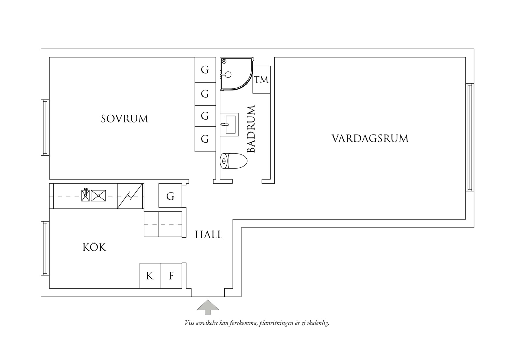

# Apartment Model

This project will create a three-dimensional model of an apartment from its floor plan. The model should provide a reliable architectural base that can be furnished and refined later. Blender integration is a future goal; no particular 3D tool or application workflow is established yet.

## Apartment layout

The supplied Swedish floor plan shows:

- **Sovrum** — bedroom
- **Badrum** — bathroom, with a shower, sink, toilet, and washing machine marked
- **Vardagsrum** — living room
- **Kök** — kitchen
- **Hall** — entrance hall

The drawing also marks built-in storage (`G`), kitchen appliances (`K` and `F`), windows, and the entrance. Preserve these features in the architectural model where they are legible.

## Reference and accuracy

Use [`assets/floor-plan.jpg`](assets/floor-plan.jpg) as the source for room arrangement and visible features. Its note says the plan is **not to scale** and that deviations may occur. No verified measurements, wall heights, or construction details are provided yet.

Do not present estimates inferred from the image as measured dimensions. Keep assumptions explicit and easy to revise; use verified measurements when they become available. Until then, any geometry based on proportions is a provisional visualization, not a dimensionally accurate or construction-ready model.

## Interior visual references

The supplied interior images are stored under [`assets/references/`](assets/references/), grouped by the room or area they primarily show. Start with the [reference catalog](assets/references/README.md) for inferred viewpoints, visible features, and cross-room clues.

These images are visual guidance, not verified survey photographs or dimensional evidence. Their provenance and consistency with the exact apartment have not been established. Use the floor plan for room adjacency and openings; confirm uncertain details and all dimensions before treating them as model facts.

## Project direction

1. Establish the apartment shell and room layout.
2. Refine openings, built-ins, and visible fixtures using confirmed information.
3. Add furniture as a later, separate layer of work.
4. Explore a Blender-based workflow when the project is ready for that integration.

## Getting started

The repository does not yet contain a 3D application, model files, or a configured build or test workflow. Choose and document those when implementation begins. Keep source assets and generated exports distinguishable, and document any steps needed to open or regenerate the model.

## Contributing

See [`AGENTS.md`](AGENTS.md) for project-specific guidance for AI coding agents and contributors.
